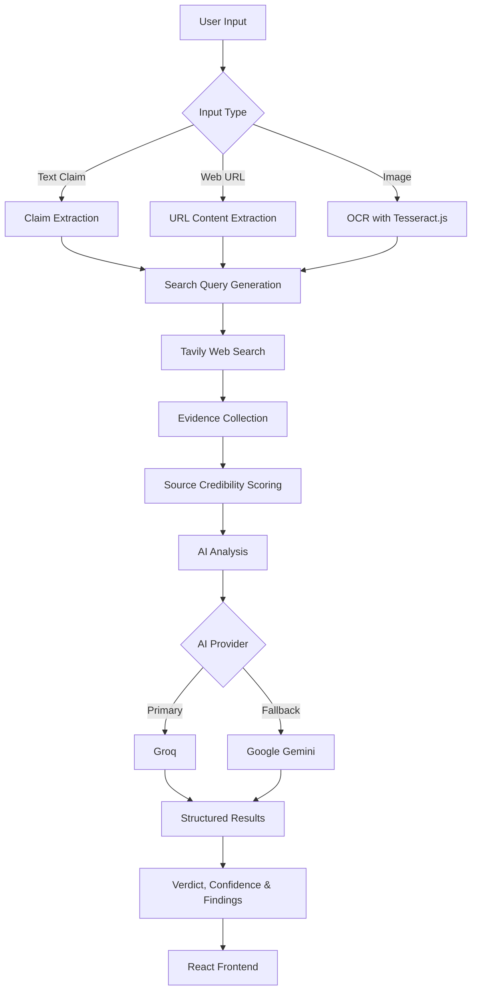
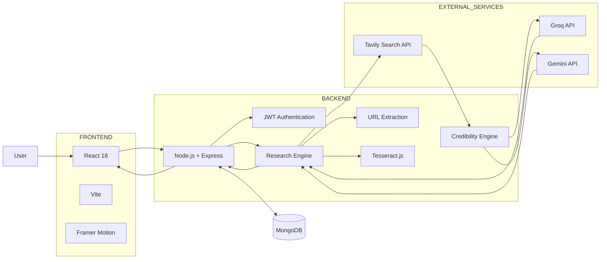

# 🚀 Aura AI

<p align="center">
  <strong>AI-Powered Claim Verification & Research Workspace</strong>
  <br />
  Investigate claims using AI-assisted reasoning, web evidence,
  source credibility analysis, URL extraction, and OCR.
  <br /><br />
  <a href="https://aura-ai-fake-news-detector.vercel.app/">
    <strong>🌐 Explore Live Application</strong>
  </a>
</p>

<p align="center">
  
  
  
  
  
</p>

<p align="center">
  <a href="#-overview">Overview</a> •
  <a href="#-features">Features</a> •
  <a href="#-architecture">Architecture</a> •
  <a href="#-tech-stack">Tech Stack</a> •
  <a href="#-installation">Installation</a> •
  <a href="#-roadmap">Roadmap</a>
</p>

---

## 📌 Recruiter Snapshot

| Category | Details |
|---|---|
| Project | Aura AI |
| Type | Full-Stack AI Research & Claim Verification Platform |
| Frontend | React 18, Vite, Framer Motion |
| Backend | Node.js, Express.js |
| Database | MongoDB, Mongoose |
| AI Providers | Groq, Google Gemini |
| Web Search | Tavily |
| OCR | Tesseract.js |
| Authentication | JWT, Google OAuth, Email/Password |
| Deployment | Vercel |
| Live Demo | [Open Aura AI](https://aura-ai-fake-news-detector.vercel.app/) |

## 🎯 Overview

Aura AI is a full-stack AI-powered research and claim-verification
platform designed to help users investigate online information
through structured analysis and evidence-based research.

Users can submit claims, webpage URLs, or images and receive
AI-assisted analysis backed by information retrieved from the web.

Instead of relying entirely on an LLM's internal knowledge,
Aura AI combines web search, source credibility assessment,
content extraction, and AI reasoning to produce more
structured research results.

**The primary objective is to make online information easier
to investigate, understand, and evaluate.**

---

## ✨ Features

### 🔍 1. AI-Powered Claim Verification

- Analyze user-submitted claims.
- Generate structured verification results.
- Present verdicts and confidence information.
- Extract important facts and findings.
- Provide supporting source references.

### 🧠 2. Multiple Research Modes

Supports three backend analysis workflows:

- **Verify Mode:** Investigates the accuracy of a claim.
- **Research Mode:** Collects information about a topic.
- **Mixed Mode:** Combines claim verification with broader research.

### 🌐 3. Web Evidence Retrieval

- Generates relevant search queries.
- Retrieves web results through Tavily.
- Uses retrieved evidence as context for AI analysis.
- Provides sources for further investigation.

### 🛡️ 4. Source Credibility Analysis

- Evaluates retrieved sources using credibility signals.
- Uses deterministic scoring.
- Supports AI-assisted credibility refinement.
- Helps users assess the reliability of available evidence.

### 🔗 5. URL Analysis

- Accepts webpage URLs as input.
- Fetches and extracts webpage content.
- Uses extracted content in the research workflow.
- Includes SSRF-focused protections for unsafe URL fetching.

### 🖼️ 6. Image & OCR Analysis

- Accepts screenshots and image inputs.
- Extracts readable text using Tesseract.js.
- Sends extracted text into the analysis pipeline.

### 🔐 7. Authentication & User Management

- Email and password authentication.
- Google OAuth integration.
- JWT-based authentication.
- Protected application routes and APIs.
- MongoDB-backed user data.

### 📚 8. Research Workspace

- User profile functionality.
- Backend analysis-history endpoints.
- Structured research results.
- Source references and investigation workflow.

---

## ⚙️ How It Works

Aura AI follows a multi-stage research and verification pipeline.



### Investigation Workflow

<details>
<summary><strong>01. Input Processing</strong></summary>

The user submits a claim, question, URL, or image.

The backend processes the input and extracts the information
required for investigation.

</details>

<details>
<summary><strong>02. Evidence Discovery</strong></summary>

The system generates relevant search queries and retrieves
web evidence through the Tavily API.

</details>

<details>
<summary><strong>03. Source Evaluation</strong></summary>

Retrieved sources are evaluated using credibility signals
and AI-assisted refinement.

</details>

<details>
<summary><strong>04. AI Reasoning</strong></summary>

The collected evidence is passed to the configured
language model for analysis and synthesis.

Groq and Gemini are supported as inference providers.

</details>

<details>
<summary><strong>05. Result Generation</strong></summary>

The application generates structured findings containing
verdict information, confidence, key facts, and source references.

</details>

---

## 🏗️ Architecture

Aura AI follows a separated frontend and backend architecture.



### Core Components

| Component | Responsibility |
|---|---|
| React Frontend | User interface and research experience |
| Express API | Backend routes and request handling |
| Research Engine | Coordinates the analysis pipeline |
| Tavily | Web evidence retrieval |
| Credibility Engine | Source evaluation |
| Groq / Gemini | AI inference and reasoning |
| Tesseract.js | Image text extraction |
| MongoDB | Persistent application data |
| JWT | Authentication and authorization |

---

## 💻 Tech Stack

### Frontend

- React 18
- Vite
- Framer Motion
- JavaScript
- Responsive CSS

### Backend

- Node.js
- Express.js
- REST APIs
- JWT Authentication

### Database

- MongoDB
- Mongoose

### AI & Research

- Groq
- Google Gemini
- Tavily Search API
- Tesseract.js

### Deployment

- Vercel
- Serverless API configuration

---

## 📂 Project Structure

```text
Aura-AI/
│
├── backend/
│   ├── config/
│   ├── controllers/
│   ├── middleware/
│   ├── models/
│   ├── routes/
│   ├── services/
│   ├── utils/
│   ├── .env
│   └── package.json
│
├── frontend/
│   ├── public/
│   ├── src/
│   │   ├── assets/
│   │   ├── components/
│   │   ├── pages/
│   │   ├── services/
│   │   └── styles/
│   ├── .env
│   └── package.json
│
├── package.json
└── README.md
```

*Note: This is a conceptual structure. Actual directories may differ.*

---

## 🚀 Installation

Follow these steps to run Aura AI locally.

### Prerequisites

Make sure you have installed:

- Node.js
- npm
- MongoDB
- Git

You will also need API credentials for Tavily and at least
one supported AI provider.

### 1. Clone the Repository

```bash
git clone YOUR_GITHUB_REPOSITORY_URL
```

```bash
cd Aura-AI
```

### 2. Install Dependencies

Run the following command from the project root:

```bash
npm run install:all
```

### 3. Configure Environment Variables

Create a `.env` file inside the `backend` directory.

```env
MONGODB_URI=your_mongodb_connection_string

JWT_SECRET=your_secure_jwt_secret

TAVILY_API_KEY=your_tavily_api_key

GROQ_API_KEY=your_groq_api_key

# Optional AI provider
GEMINI_API_KEY=your_gemini_api_key

# Frontend origin
CORS_ORIGINS=http://localhost:5173

# Google OAuth (if enabled)
GOOGLE_CLIENT_ID=your_google_client_id
```

### 4. Configure Frontend API URL

The frontend uses the backend API URL configured by the project.

For a separately hosted API, configure:

```env
VITE_API_URL=https://your-api-domain.com
```

### 5. Start Development Servers

Run from the root directory:

```bash
npm run dev
```

The frontend runs using Vite.

The default local API URL is:

```text
http://localhost:5000
```

---

## 🔑 Environment Variables

| Variable | Purpose |
|---|---|
| `MONGODB_URI` | MongoDB database connection |
| `JWT_SECRET` | JWT signing secret |
| `TAVILY_API_KEY` | Web search integration |
| `GROQ_API_KEY` | Groq AI inference |
| `GEMINI_API_KEY` | Gemini AI inference |
| `CORS_ORIGINS` | Allowed frontend origins |
| `GOOGLE_CLIENT_ID` | Google OAuth configuration |
| `VITE_API_URL` | Optional frontend API URL override |

**Security:** Never commit real API keys, passwords, JWT secrets,
or `.env` files to GitHub.

---

## 🔒 Security Considerations

Security is an important part of the application.

Current implementation includes:

- JWT-based authentication.
- Protected backend functionality.
- Environment-based secret configuration.
- SSRF-focused protections for URL extraction.
- Source validation and structured processing.

User-submitted information and AI-generated results should
always be treated as untrusted until independently verified.

---

## 🗺️ Roadmap

The following improvements are planned or in progress.

- [ ] Complete frontend integration for Verify, Research, and Mixed modes.
- [ ] Integrate backend analysis-history APIs into frontend conversation history.
- [ ] Expand automated backend and frontend tests.
- [ ] Add comprehensive research-pipeline evaluation.
- [ ] Improve production error handling and logging.
- [ ] Complete multi-user deployment testing.
- [ ] Add screenshots and a detailed project walkthrough.

---

## 🧪 Future Improvements

Potential areas for further development:

- Advanced source ranking and evidence comparison.
- Improved claim-to-evidence relationship visualization.
- More comprehensive research history.
- Better AI evaluation and reliability metrics.
- Enhanced testing and monitoring.
- Improved accessibility and user experience.

---

## ⚠️ Important Disclaimer

Aura AI is an AI-assisted research and claim-verification tool.

AI-generated verdicts are not guaranteed to be accurate.
Users should inspect original sources and independently
evaluate evidence before making important decisions.

---

## 👨‍💻 Project

**Aura AI — AI-Powered Claim Verification & Research Workspace**

🌐 Live Application:

https://aura-ai-fake-news-detector.vercel.app/

---

<p align="center">
  <strong>Built with React, Node.js, MongoDB and AI.</strong>
  <br />
  Making online research more evidence-driven.
  <br /><br />
  <a href="https://aura-ai-fake-news-detector.vercel.app/">
    🚀 Explore Aura AI
  </a>
</p>